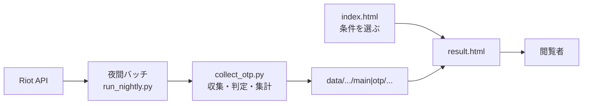

# OTP Off-Role Insights

[デモ（GitHub Pages）](https://a-a81.github.io/otp-off-role-insights/)

ゲームを始めてメインのチャンピオン（キャラクター）が決まった初心者が、他のレーン（ポジション）をプレイするときに参考にするための Web アプリです。上位帯でそのチャンピオンを主に使っているプレイヤーが、他のレーンではどんなチャンピオンを使っているかを統計として見せます。

例: 「Support の Blitzcrank を主に使う上位プレイヤーは、MID に配属されたとき Lissandra をよく使う」

詳しい仕様は [SPEC.md](SPEC.md) にあります。

---

## 使い方（閲覧）

1. [デモサイト](https://a-a81.github.io/otp-off-role-insights/) を開く
2. リージョン・メインレーン・集計対象（メイン / OTP）・チャンピオンを選んで検索する
3. 結果ページで、その他のレーンでのピック率を見る（集計対象は結果ページでも切り替えられる）

手元で見る場合は、このフォルダで静的サーバーを立ててください（`file://` だと JSON が読めないことがあります）。

```bash
python -m http.server 8000
```

ブラウザで `http://localhost:8000/` を開きます。

---

## 仕組み



夜間にマスター以上のソロキュー（JP / KR / NA）を集め、集計 JSON だけを公開します。画面は静的ファイルのみで、閲覧時に Riot API は叩きません。

1. `collect_otp.py` がレート帯のプレイヤー一覧と試合を取り、プレイヤーごとにメインレーンとメインチャンピオンを判定する
2. メインレーン以外の試合を「他レーン」として集計し、`data/<region>/main|otp/champions/<id>.json` に書く
3. 検索画面で選んだ条件で結果ページが、その JSON の `byMainLane` を読んで表示する（例: Support Blitzcrank → MID のピック）

集計対象は 2 種類あり、別々のフォルダに出します。

| 集計 | 意味 | メインレーンでの使用率 | 出力 |
|---|---|---|---|
| メイン | そのチャンピオンをよく使う人 | 30% 以上 | `data/<region>/main/` |
| OTP | ほぼそのチャンピオンしか使わない人 | 75% 以上 | `data/<region>/otp/` |

「JP+KR+NA 合計」は各リージョンの保存データから `--combine` で作ります（API は追加で叩きません）。

---

## 工夫したところ

- **閲覧と収集を分ける**: サイトは夜間に作った JSON だけを読むので、公開サーバーに API キーが要りません。GitHub Pages で足ります。
- **判定を保存データからやり直せる**: プレイヤー単位の試合は `players/` に残し、しきい値を変えたら `--rebuild-only` で API なしに再集計できます。
- **途中再開できる**: プレイヤー単位で進むので、中断しても続きから集め直せます。
- **リージョン合計は API なし**: `--combine` が各リージョンの `players/` をまとめて `data/all/` を作ります。
- **検索は表記ゆれに強い**: ひらがな／カタカナ、全角／半角、記号を正規化して候補を出します。

---

## データ収集（自分で回す場合）

必要なもの:

- Python 3.10+（標準ライブラリのみ）
- [Riot Developer](https://developer.riotgames.com/) の API キー

```bash
# Windows（PowerShell）
$env:RIOT_API_KEY = "RGAPI-..."

# 動作確認（API なし）
python collect_otp.py --self-test

# 少人数だけ試す
python collect_otp.py --region JP --limit 20

# しきい値だけ変えて再集計（API なし）
python collect_otp.py --rebuild-only --otp-rate 0.7

# 各リージョンの合計（data/all/）を作る
python collect_otp.py --combine
```

主なオプション:

| オプション | 既定 | 内容 |
|---|---|---|
| `--region` | JP | JP / KR / NA |
| `--tiers` | 全部 | CHALLENGER / GRANDMASTER / MASTER |
| `--matches` | 40 | 1 人あたりの直近試合数 |
| `--limit` | 全員 | 今回試合を取る人数 |
| `--main-rate` / `--otp-rate` | 0.3 / 0.75 | 集計の使用率しきい値 |
| `--refresh` | - | 期限切れのデータを取り直す |
| `--rebuild-only` | - | API を叩かず JSON を作り直す |
| `--combine` | - | リージョン合計を作る |

JP と KR は試合 API がどちらも `asia` なので、同時に動かさず順番に実行してください。NA（`americas`）は並行して構いません。

### 夜間バッチ

毎日まとめて回すときは `run_nightly.py` を使います。

1. `nightly.example.json` を `nightly.local.json` にコピーする（Git 管理外）
2. `riotApiKey` などを書く
3. 実行:

```bash
python run_nightly.py
```

Windows のタスクスケジューラ登録例:

```powershell
.\register_nightly_task.ps1
```

`gitPush: true` にすると、公開用 JSON を commit / push できます。PUUID を含む `players/` やキャッシュは `.gitignore` 済みです。

---

## 構成

```
collect_otp.py              収集・判定・集計
run_nightly.py              夜間処理のオーケストレーション
update_champion_names.py    Data Dragon からチャンピオン名を更新
index.html / result.html    検索画面・結果画面
i18n.js / champions.js      文言・表示ヘルパー
style.css
data/                       公開用 JSON（players / cache は非公開）
SPEC.md                     仕様書
```

---

## 注意

OTP Off-Role Insights isn't endorsed by Riot Games and doesn't reflect the views or opinions of Riot Games or anyone officially involved in producing or managing Riot Games properties. Riot Games, and all associated properties are trademarks or registered trademarks of Riot Games, Inc.

API の利用は [Riot Developer の規約](https://developer.riotgames.com/policies/general)に従ってください。開発用キーはレート制限が厳しいので、本番キーを取るまでは `--limit` や `--tiers` で範囲を絞ることを推奨します。
