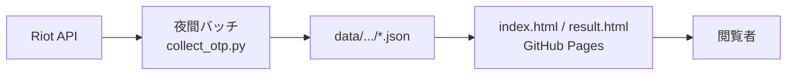

# OTP Off-Role Insights

[デモ（GitHub Pages）](https://a-a81.github.io/otp-off-role-insights/)

高ランク帯で 1 体を主に使うプレイヤー（OTP / メイン）が、**メイン以外のレーン**に回ったとき、どのチャンピオンを使っているかを統計として見せる Web アプリです。

例: 「MID の Yasuo OTP は、TOP に回ると Sett をよく使う」

- マスター以上のソロキュー（JP / KR / NA）を夜間に集め、集計 JSON だけを公開します
- 画面は静的ファイルのみ。閲覧時に Riot API は叩きません
- 日本語・英語・韓国語に対応しています

詳しい仕様は [SPEC.md](SPEC.md) にあります。

---

## 使い方（閲覧）

1. [デモサイト](https://a-a81.github.io/otp-off-role-insights/) を開く
2. リージョン・メインレーン・チャンピオンを選ぶ
3. 「メイン」（使用率 30% 以上）か「OTP」（75% 以上）で集計対象を切り替える
4. その他のレーンでのピック率を見る

手元で見る場合は、このフォルダで静的サーバーを立ててください（`file://` だと JSON が読めないことがあります）。

```bash
python -m http.server 8000
```

ブラウザで `http://localhost:8000/` を開きます。

---

## 仕組み



| 層 | 役割 |
|---|---|
| 夜間バッチ | リーグ・熟練度・試合を取り、プレイヤー判定と集計 JSON を書く |
| 静的フロント | 選んだ条件の JSON を直接読んで表示する |

しきい値は 2 種類あり、別々に集計します。

| 集計 | メインレーンでの使用率 | 出力 |
|---|---|---|
| メイン | 30% 以上 | `data/<region>/main/` |
| OTP | 75% 以上 | `data/<region>/otp/` |

---

## 工夫したところ

- **閲覧と収集を分ける**: サイトは夜間に作った JSON だけを読むので、公開サーバーに API キーが要りません。GitHub Pages で足ります。
- **判定を保存データからやり直せる**: プレイヤー単位の試合は `players/` に残し、しきい値を変えたら `--rebuild-only` で API なしに再集計できます。
- **熟練度で先に絞る**: 全員の試合を取ると開発用キーでは数十時間かかるため、熟練度の偏りで候補を絞れます（`--mastery-ratio`。`0` で無効）。
- **途中再開できる**: プレイヤー単位で進むので、中断しても続きから集め直せます。
- **リージョン合計は API なし**: `--combine` が各リージョンの `players/` をまとめて `data/all/` を作ります。
- **検索は表記ゆれに強い**: ひらがな／カタカナ、全角／半角、記号を正規化して候補を出します。

---

## データ収集（自分で回す場合）

必要なもの:

- Python 3.10+（標準ライブラリのみ）
- [Riot Developer](https://developer.riotgames.com/) の API キー

```bash
# Windows（PowerShell）
$env:RIOT_API_KEY = "RGAPI-..."

# 動作確認（API なし）
python collect_otp.py --self-test

# 少人数だけ試す
python collect_otp.py --region JP --limit 20

# しきい値だけ変えて再集計（API なし）
python collect_otp.py --rebuild-only --otp-rate 0.7

# 各リージョンの合計（data/all/）を作る
python collect_otp.py --combine
```

主なオプション:

| オプション | 既定 | 内容 |
|---|---|---|
| `--region` | JP | JP / KR / NA |
| `--tiers` | 全部 | CHALLENGER / GRANDMASTER / MASTER |
| `--matches` | 40 | 1 人あたりの直近試合数 |
| `--limit` | 全員 | 今回試合を取る人数 |
| `--main-rate` / `--otp-rate` | 0.3 / 0.75 | 集計の使用率しきい値 |
| `--mastery-ratio` | 1.5 | 熟練度 1 位 / 2 位の倍率。0 で無効 |
| `--refresh` | - | 期限切れのデータを取り直す |
| `--rebuild-only` | - | API を叩かず JSON を作り直す |
| `--combine` | - | リージョン合計を作る |

JP と KR は試合 API がどちらも `asia` なので、同時に動かさず順番に実行してください。NA（`americas`）は並行して構いません。

### 夜間バッチ

毎日まとめて回すときは `run_nightly.py` を使います。

1. `nightly.example.json` を `nightly.local.json` にコピーする（Git 管理外）
2. `riotApiKey` などを書く
3. 実行:

```bash
python run_nightly.py
```

Windows のタスクスケジューラ登録例:

```powershell
.\register_nightly_task.ps1
```

`gitPush: true` にすると、公開用 JSON を commit / push できます。PUUID を含む `players/` やキャッシュは `.gitignore` 済みです。

---

## 構成

```
collect_otp.py              収集・判定・集計
run_nightly.py              夜間処理のオーケストレーション
update_champion_names.py    Data Dragon からチャンピオン名を更新
index.html / result.html    検索画面・結果画面
i18n.js / champions.js      文言・表示ヘルパー
style.css
data/                       公開用 JSON（players / cache は非公開）
SPEC.md                     仕様書
```

---

## 注意

OTP Off-Role Insights isn't endorsed by Riot Games and doesn't reflect the views or opinions of Riot Games or anyone officially involved in producing or managing Riot Games properties. Riot Games, and all associated properties are trademarks or registered trademarks of Riot Games, Inc.

API の利用は [Riot Developer の規約](https://developer.riotgames.com/policies/general)に従ってください。開発用キーはレート制限が厳しいので、本番キーを取るまでは `--limit` や `--tiers` で範囲を絞ることを推奨します。
